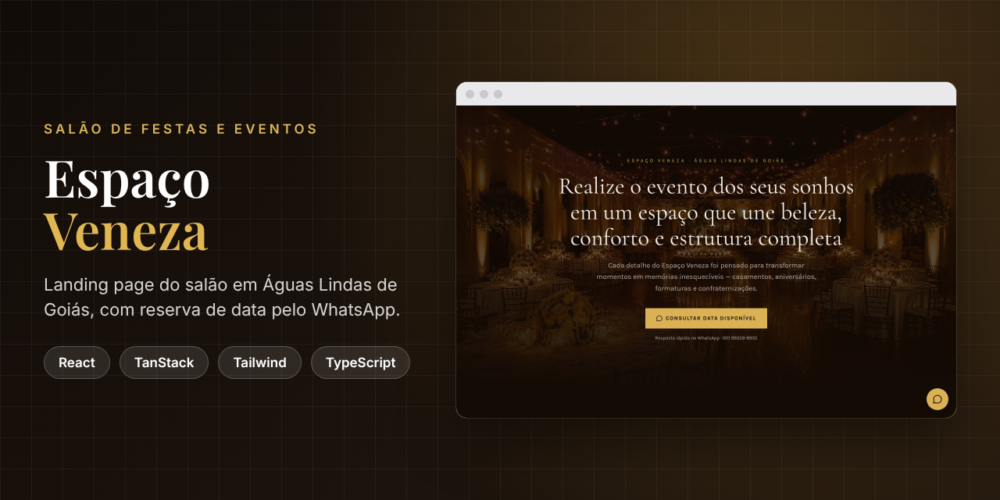
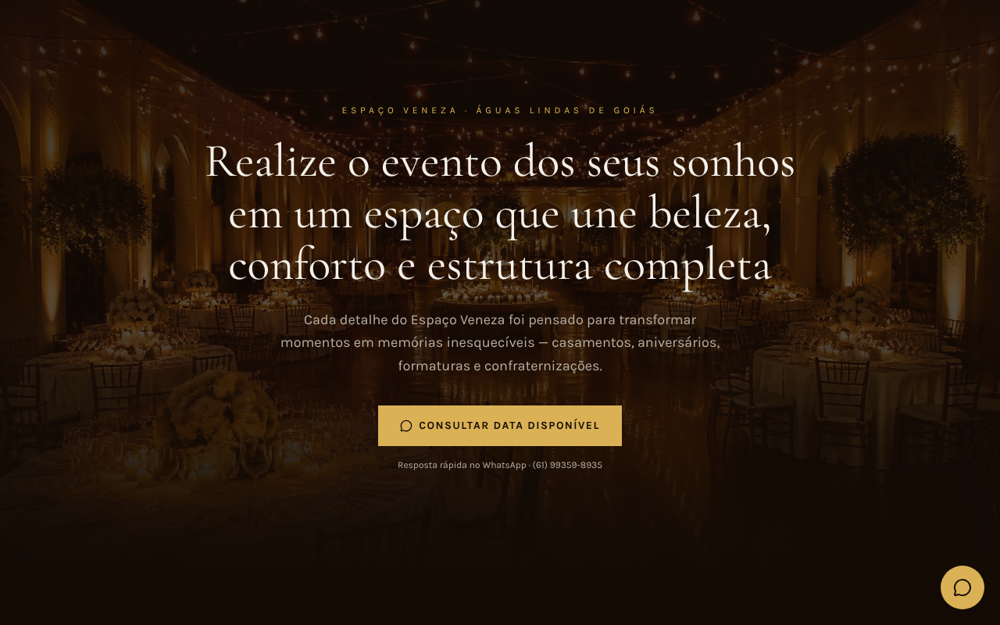
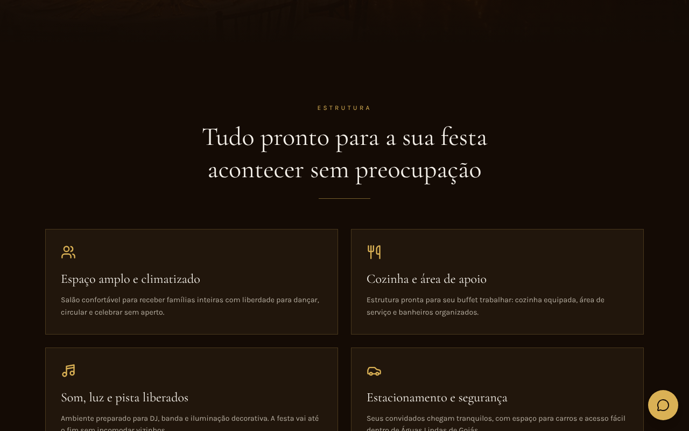
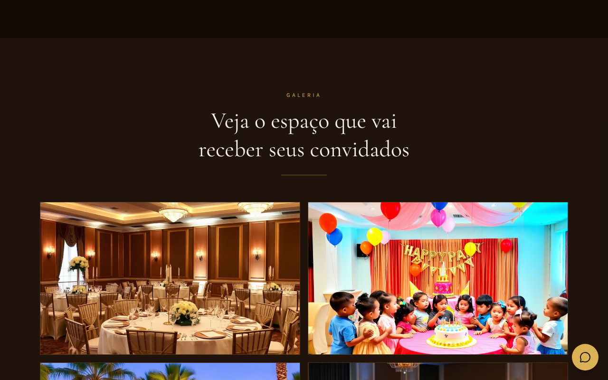
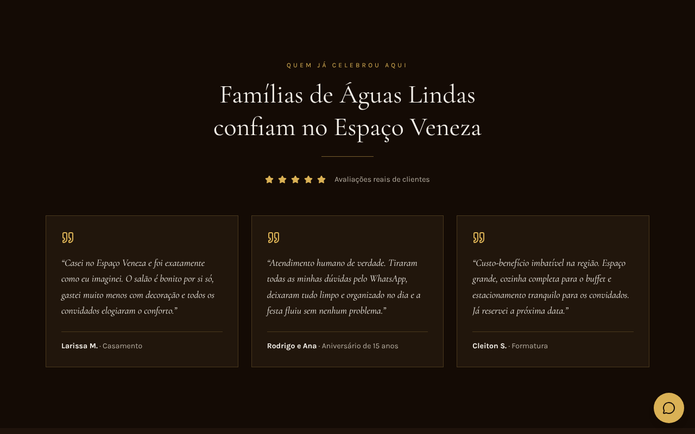
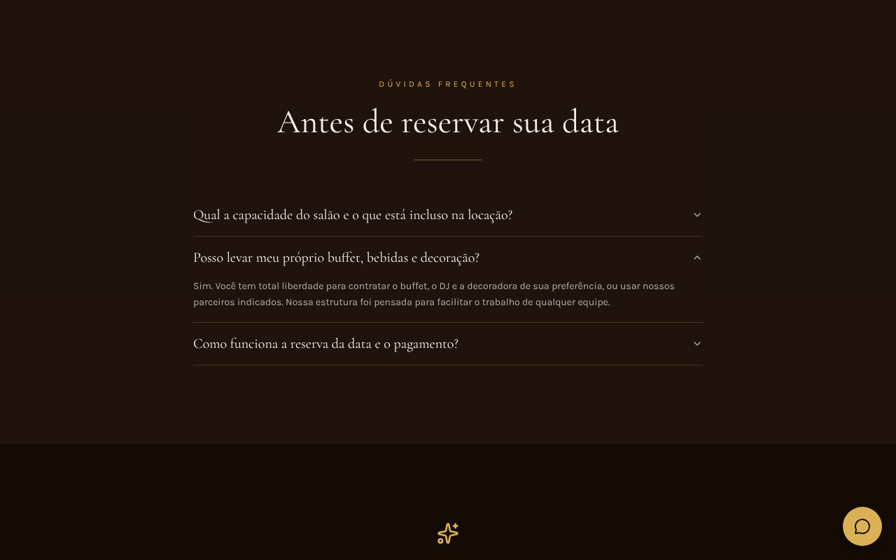

<p align="center">
  
</p>

<h1 align="center">🎉 Espaço Veneza — Landing Page</h1>

<p align="center">
  Landing page de alta conversão para o salão de festas e eventos <b>Espaço Veneza</b>, em
  <b>Águas Lindas de Goiás (GO)</b>: apresenta a estrutura, tira dúvidas e leva o cliente direto ao <b>WhatsApp</b>.
</p>

<p align="center">
  <a href="https://veneza-event-dream.lovable.app"></a>
  
  
  
  
  
</p>

<p align="center">
  <a href="#-sobre-o-projeto">Sobre</a> •
  <a href="#-funcionalidades">Funcionalidades</a> •
  <a href="#-telas">Telas</a> •
  <a href="#-como-executar">Como executar</a> •
  <a href="#-estrutura-do-projeto">Estrutura</a> •
  <a href="#-tecnologias">Tecnologias</a>
</p>

---

## 📌 Sobre o projeto

Landing page desenvolvida para o salão de festas e eventos **Espaço Veneza**, localizado em Águas Lindas de Goiás.
O objetivo é apresentar a estrutura do local, responder às dúvidas frequentes, destacar a prova social e guiar o
cliente para um atendimento direto pelo **WhatsApp**.

A página foi pensada para neutralizar objeções comuns antes da contratação (calor, estrutura para o buffet,
estacionamento, como funciona a reserva) e termina sempre numa chamada para consultar a data.

🌍 **Versão publicada:** [veneza-event-dream.lovable.app](https://veneza-event-dream.lovable.app)

## ✨ Funcionalidades

| | Recurso | Descrição |
|---|---|---|
| 🌟 | **Hero** | Primeira tela focada no "evento dos sonhos", com chamada forte para o WhatsApp |
| 🏛️ | **Estrutura** | Espaço climatizado, cozinha e área de apoio, som/luz/pista e estacionamento |
| 🖼️ | **Galeria** | Fotos de casamento, festa infantil, área externa com piscina e formatura |
| 💬 | **Depoimentos** | Prova social com relatos de clientes por tipo de evento |
| ❓ | **Dúvidas frequentes** | Acordeão (Radix UI) com capacidade, buffet próprio e forma de reserva |
| 📍 | **Rodapé e localização** | Endereço, rota no Google Maps, contato e horário de atendimento |
| 📲 | **WhatsApp** | Botões de chamada e botão flutuante com mensagem pronta de consulta de data |
| 🔎 | **SEO** | Título, descrição e tags Open Graph definidos na rota |
| 📱 | **Responsivo** | Layout adaptado para celular, sem rolagem lateral |

## 🖼️ Telas

<table>
  <tr>
    <td align="center"><b>Página inicial</b><br></td>
    <td align="center"><b>Estrutura</b><br></td>
  </tr>
  <tr>
    <td align="center"><b>Galeria</b><br></td>
    <td align="center"><b>Depoimentos</b><br></td>
  </tr>
  <tr>
    <td align="center"><b>Dúvidas frequentes</b><br></td>
    <td align="center"><b>Celular</b><br></td>
  </tr>
</table>

## 🚀 Como executar

**Pré-requisito:** [Node.js](https://nodejs.org/pt-br/) instalado (o projeto também tem `bun.lock`, se preferir o Bun).

```bash
git clone https://github.com/kauaxp77/veneza-event-dream.git
cd veneza-event-dream
npm install
npm run dev
```

O terminal mostra o endereço local (normalmente `http://localhost:5173` ou similar). Basta **segurar Ctrl e
clicar no link** ou copiá-lo para o navegador. Para parar, aperte `Ctrl + C` no terminal.

Para gerar a versão de produção:

```bash
npm run build
```

O build usa o Nitro com destino Cloudflare e gera a pasta `.output/`.

## 📁 Estrutura do projeto

```
veneza-event-dream/
├── src/
│   ├── routes/
│   │   ├── __root.tsx       # Layout raiz (html, head, fontes) que envolve todas as páginas
│   │   └── index.tsx        # A landing page: hero, estrutura, galeria, depoimentos, FAQ e rodapé
│   ├── components/ui/       # Componentes shadcn/ui (Radix UI)
│   ├── assets/              # Foto do topo e imagens da galeria
│   ├── hooks/ e lib/        # Utilitários e captura de erros
│   ├── router.tsx           # Configuração do TanStack Router
│   ├── routeTree.gen.ts     # Árvore de rotas (gerada automaticamente)
│   ├── server.ts            # Entrada do servidor (SSR)
│   └── styles.css           # Tailwind e tema (cores e fontes)
├── public/                  # Favicon e robots.txt
├── docs/                    # Banner e capturas de tela deste README
├── vite.config.ts           # Configuração do Vite (Lovable + TanStack Start)
└── package.json
```

> As rotas seguem o roteamento por arquivos do TanStack Start: cada `.tsx` em `src/routes/` vira uma página
> (veja [`src/routes/README.md`](src/routes/README.md)).

## 🛠️ Tecnologias

- **React 19 & Vite**: base do projeto, focada em desempenho
- **TanStack Start / TanStack Router**: rotas por arquivo e renderização no servidor
- **Tailwind CSS**: visual responsivo e personalizado
- **Radix UI / shadcn-ui**: componentes acessíveis (como o acordeão do FAQ)
- **Lucide React**: ícones
- **TypeScript**: tipagem e manutenção
- **Lovable**: geração e publicação do projeto

## 👨‍💻 Autor

Desenvolvido por **[kauaxp77](https://github.com/kauaxp77)** para o Espaço Veneza • Águas Lindas de Goiás — GO

<p align="center">⭐ Se curtiu o projeto, deixe uma estrela!</p>
